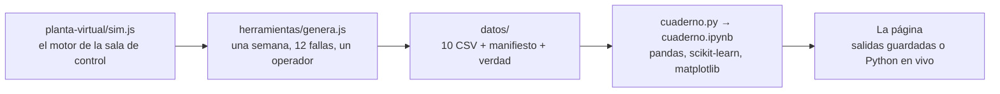

# Cuaderno de planta

**Una semana de la [planta virtual LX-SX-EW](https://jsnn15.github.io/copper_plant_simulator_2026/) leída desde sus datos crudos, en un notebook de Jupyter que también se ejecuta en el navegador.**

[Abrir el cuaderno](https://jsnn15.github.io/cuaderno/) · [`cuaderno.ipynb`](cuaderno.ipynb) (GitHub lo muestra con sus salidas)

## Qué responde

| Caso de uso | Sin el análisis | Con el análisis |
|---|---|---|
| Datos confiables | 580 celdas malas entran a los cálculos sin aviso | Las pruebas marcan los 7 defectos sembrados y ninguno de más |
| Qué pasó en la semana | 121 t bajo el plan, sin causa a la vista | El 79 % de la baja cae en los 7 turnos con mineral distinto |
| Alarmas | 50 anuncios; 29 son dos alarmas que repican | 28 anuncios con un retardo de 60 s |
| Vibración | La alarma por límite avisa 1,7 h antes del disparo | La tendencia avisa 4,3 h antes y pone hora al disparo |
| pH: sensor o proceso | La alarma de planta tarda 110 y 410 min | El detector tarda 29 y 168 min, y dice si es el sensor |
| Anticipar la producción a 4 h | Suponer que nada cambia: 0,73 t/h de error cuando cambia el mineral | Un modelo con ocho semanas de historia: 0,27 t/h |

Con una sola semana de datos el pronóstico no le gana a la persistencia; el cuaderno muestra ese intento y el de ocho semanas.

## De dónde salen los datos



El generador corre el mismo motor de la planta virtual durante una semana simulada (2 al 9 de noviembre de 2026), dispara fallas a horas fijas y hace responder a un operador según un guion. Un segundo generador corre ocho semanas con cambios de mineral, solo para el caso de pronóstico. Todo es determinista: con la misma versión de `sim.js` salen los mismos archivos, y el manifiesto guarda la huella de cada uno.

| Archivo | Sistema que imita | Contenido |
|---|---|---|
| `historiador.csv` | DCS / historiador | 49 tags de proceso, una fila por minuto |
| `alarmas.csv` | Sistema de alarmas | Activación, reconocimiento y normalización |
| `bitacora.csv` | Sala de control | Órdenes, disparos, secuencias y mantenimiento |
| `vibraciones.csv` | Monitoreo de condición | 16 motores, una lectura cada 5 min |
| `laboratorio.csv` | Laboratorio | pH del PLS cada 2 h y compósito de cátodo por turno |
| `turnos.csv` | Reporte de turno | Producción, consumos, pérdidas y alarmas |
| `tags.csv`, `equipos.csv` | Configuración | Diccionario de tags y límites de vibración por motor |
| `historiador_8_semanas.csv` y `_eventos.csv` | DCS / historiador | Campaña larga para el pronóstico: 15 cambios de mineral, medias de 10 min |
| `verdad.json` | No existe en una planta | Lo que se sembró. El cuaderno no lo lee para detectar, solo para medir si detectó |

### Qué agrega el generador sobre el motor

- **Ruido de medición:** gaussiano, 0,15 % del rango de cada instrumento. El motor entrega el valor del proceso sin ruido.
- **Defectos de adquisición en el historiador:** una pérdida de comunicación de 47 min, un transmisor congelado 3 h 20 min, tres lecturas imposibles, dos filas repetidas y 12 minutos sin registros.
- **Respuestas del operador:** tiempos de reconocimiento y maniobras de recuperación. Son un guion; no dicen nada sobre operadores reales.

## Repetirlo

```bash
node herramientas/genera.js ../planta-virtual/sim.js datos/      # la semana, desde el motor
node herramientas/genera_largo.js ../planta-virtual/sim.js datos/historiador_8_semanas.csv   # ocho semanas, para el pronóstico
python herramientas/ejecuta.py claro cuaderno.ipynb             # ejecuta el cuaderno con Jupyter
python herramientas/comprueba.py cuaderno.ipynb                 # las cifras del texto calzan con las salidas
python herramientas/publica.py && (cd web && npm install && npm run build)   # la página
```

Necesita Node y Python con `pandas`, `scikit-learn`, `matplotlib`, `jupytext`, `nbclient` e `ipykernel`. Las salidas publicadas se ejecutaron con Node 22, Python 3.13, pandas 3.0 y scikit-learn 1.9.

## Python en el navegador

El botón «Arrancar Python» carga [Pyodide](https://pyodide.org) 314 en un Web Worker, trae los mismos archivos de datos y ejecuta las celdas tal como están escritas. Se puede editar cualquier celda, agregar otras y subir un CSV propio, que no sale del navegador. Baja unos 25 MB la primera vez; la sección 7 usa scikit-learn y suma 18 MB.

En la prueba, el cuaderno completo corrió en vivo en unos 12 segundos después de arrancar, sin errores, y dio los mismos resultados que la versión guardada. Las versiones de las librerías en Pyodide (Python 3.14, pandas 3.0.2, scikit-learn 1.8) no son idénticas a las de la ejecución guardada.

## Límites

- Son datos de un simulador. Las fallas avanzan más rápido que en una planta: el rodamiento pasa de sano a disparo en cuatro horas.
- El pronóstico de vibración se probó en dos episodios del mismo motor. Muestra el método; no lo valida.
- El umbral que separa «sensor» de «proceso» en el pH (0,05) se eligió mirando esta misma semana.
- Los valores de referencia de alarmas son los de ISA-18.2; con una semana y un solo operador simulado, los porcentajes por prioridad son poco representativos.
- El pronóstico de la sección 7 se probó con dos semanas de datos simulados y no anticipa un disparo del rectificador. En una planta real la respuesta al mineral no es tan limpia.

## Archivos

| Ruta | Qué es |
|---|---|
| `cuaderno.py` | El cuaderno en texto (formato de celdas de jupytext). Es la fuente que se edita |
| `cuaderno.ipynb` | El mismo cuaderno ejecutado, con sus salidas |
| `datos/` | Los archivos crudos, el manifiesto con huellas y `verdad.json` |
| `herramientas/genera.js`, `genera_largo.js` | Generan la semana y la campaña de ocho semanas con el motor de la planta virtual |
| `herramientas/ejecuta.py`, `comprueba.py`, `publica.py` | Ejecuta el cuaderno, comprueba las cifras del texto y arma la página |
| `claro.mplstyle`, `oscuro.mplstyle` | Estilo de los gráficos para cada tema |
| `web/` | Código de la página: celdas, panel de datos y el kernel de Pyodide (`web/public/kernel.js`) |
| `planilla/`, `fuente/` | La herramienta anterior: analizar una planilla propia sin escribir código |

---

<sub>Proyecto personal de **Julián Neira Nova**, ingeniero eléctrico · Servicio y Soluciones Tecnológicas DelaCruz SpA. Nada de lo publicado proviene de clientes ni de empleadores.
[Portafolio](https://jsnn15.github.io/) · [LinkedIn](https://www.linkedin.com/in/julian-neira-nova/) · [Todas las herramientas](https://github.com/JSNN15)</sub>
