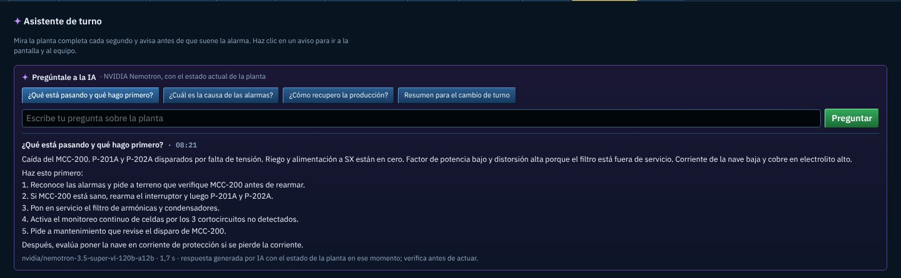

# Propuesta · Asistente de turno con IA de NVIDIA

Estado: **propuesta, no publicada.** Requiere un servidor propio, así que no corre en GitHub Pages.



## Qué haría
El operador le pregunta a la planta en lenguaje natural, por ejemplo "¿qué está pasando y qué hago primero?" o "resumen para el cambio de turno". Un modelo de NVIDIA responde con el estado real del simulador:
- alarmas activas, equipos detenidos, variables clave y últimos eventos;
- las relaciones de causa del modelo de la planta;
- solo las acciones que existen en la sala.

## Por qué no está en el portafolio
- **La clave necesita un servidor.** Una clave de API no puede ir en un sitio estático: cualquiera la copiaría.
- **NVIDIA no acepta llamadas desde el navegador.** La API de NVIDIA no responde con CORS, así que la página tampoco puede llamarla directo.

## Cómo se publicaría
Como aplicación en un servidor propio, en un solo dominio:
- la planta virtual, igual que hoy;
- un endpoint `/api/ask` que guarda la clave como variable de entorno, fija el modelo y el mensaje de sistema, y limita las consultas;
- un contenedor Docker.

## Qué ya está hecho y probado
| Archivo | Qué es |
|---|---|
| `contexto.js` | Resume el estado de la planta para el modelo (4 a 5 KB de texto) y envía la consulta |
| `servicio.js` | Lógica del endpoint: modelo y sistema fijos, recorte del contexto, límite por IP y origen permitido |
| `prueba.test.mjs` | 6 pruebas sin red: CORS, origen, modelo fijo, recortes, error sin clave, límite y contenido del resumen |
| `captura.jpg` | Prueba de punta a punta con la API de NVIDIA |

La interfaz probada (preguntas rápidas, campo libre y respuesta con modelo y tiempo) quedó en el historial: commit `f77e096`, PR #5.

**Prueba real**, con cuatro escenarios: caída del MCC-200, racha de cortocircuitos, disparo del rectificador y cambio de turno. Las respuestas tardaron entre 1,7 y 4,6 s y nombraron tags y valores reales.

**Modelo elegido:** `nvidia/nemotron-3.5-super-vl-120b-a12b`. Se descartaron dos:
- `nemotron-3.5-lightning-30b-a3b` atribuía causas que los datos no mostraban;
- `nemotron-3-ultra-550b-a55b` tardaba unos 13 s.

```bash
node planta-virtual/propuesta-ia/prueba.test.mjs
```

## Para llevarla a producción
1. Definir el servidor y el dominio.
2. Portar `servicio.js` a un endpoint `/api/ask` en Node o Python, con la clave en una variable de entorno.
3. Recuperar la interfaz del commit `f77e096` y apuntarla a `/api/ask`.
4. Definir quién la usa (demostración pública con límite, o con inicio de sesión) y un tope de gasto.
